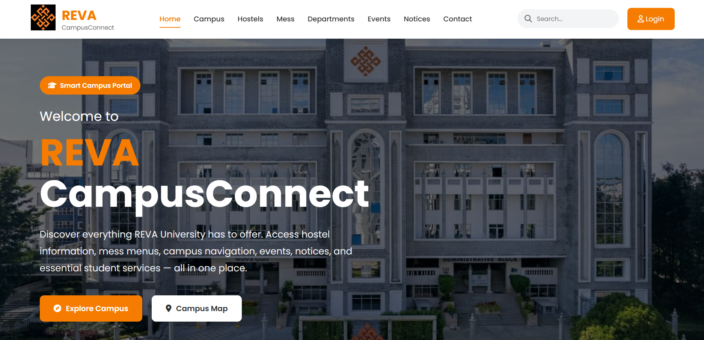
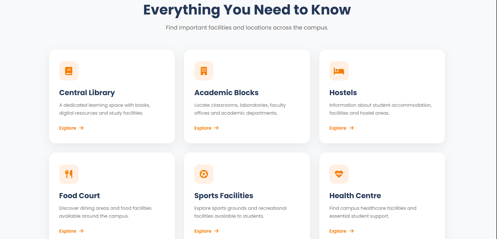
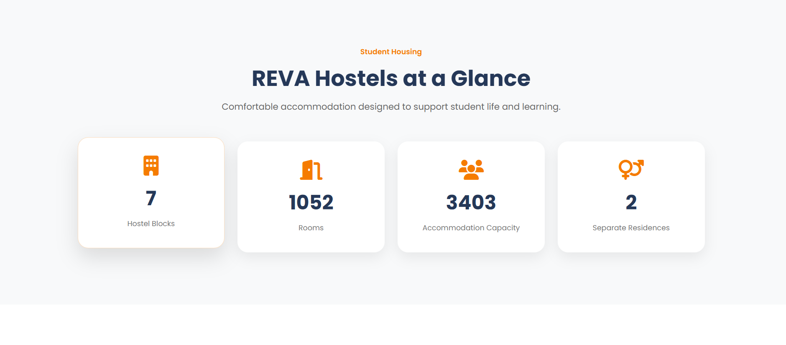
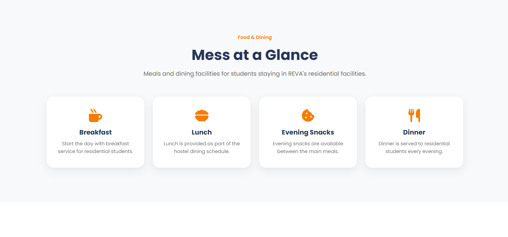
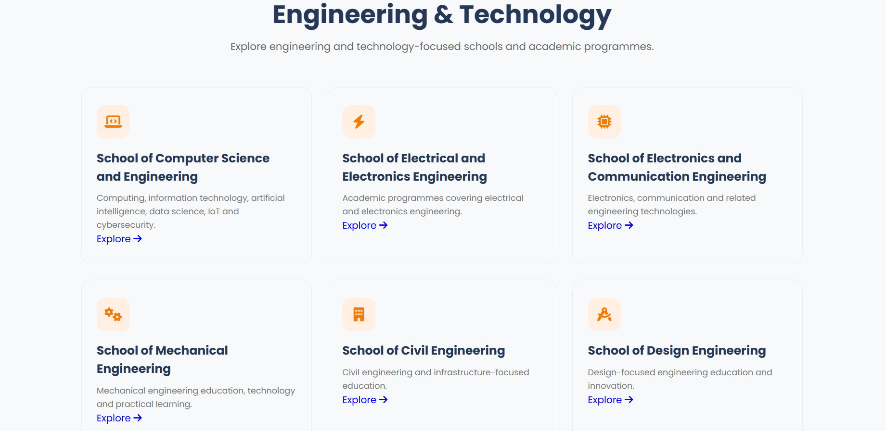
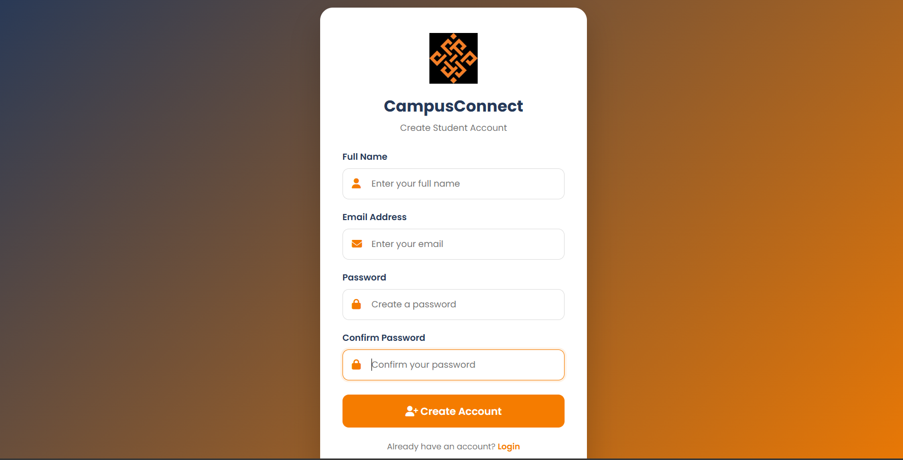
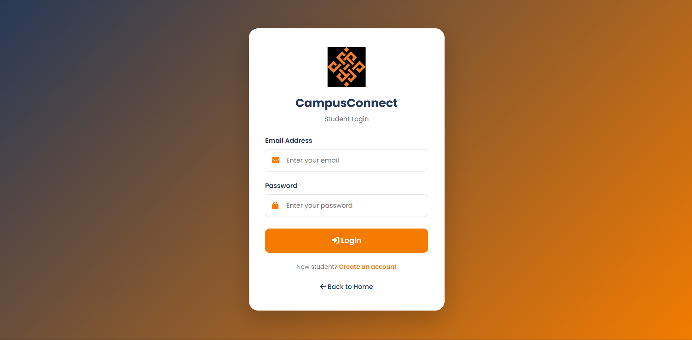

CampusConnect – REVA University Campus Website
📖 1. Project Introduction
CampusConnect is a web-based campus information portal developed for REVA University, Bengaluru.

The application provides students, prospective students, parents and campus visitors with a centralized platform to explore important university information, including academic departments, campus facilities, hostels, mess schedules, events and contact details.

It also includes a student authentication subsystem that supports student registration and credential verification through a Java Spring Boot backend connected to a MySQL database.

The project combines a responsive frontend with backend authentication and database integration to provide a unified campus information experience.
Key Highlights
- Multi-page university information portal.
- Student registration and login functionality.
- Java Spring Boot REST API backend.
- MySQL database integration.
- Secure password hashing using BCrypt.
- Interactive department search and FAQ sections.
- Responsive frontend design.
- Centralized campus information.
🎯 2. Problem Statement
University-related information is often distributed across different websites, brochures, notice boards and communication channels.

Students and visitors may find it difficult to locate important information about campus facilities, hostel accommodation, mess schedules, academic departments and university events.

CampusConnect addresses this problem by providing a centralized digital platform for accessing important REVA University campus information.
Problems Addressed
1. Information Fragmentation: Campus-related information is spread across multiple sources.
2. Student Onboarding: New students need an accessible platform to explore university facilities.
3. Hostel Information: Students require convenient access to hostel facilities, guidelines and accommodation details.
4. Mess Information: Students need information about daily meal schedules and available food options.
5. Student Registration: Provides a backend-supported student registration and credential verification system.
🏆 3. Project Objectives
1. Develop a centralized campus information website for REVA University.
2. Provide information about university facilities and academic departments.
3. Display hostel facilities and mess schedules.
4. Provide campus contact and location information.
5. Implement student registration and login functionality.
6. Develop REST APIs using Java Spring Boot.
7. Integrate MySQL for storing student information.
8. Implement password hashing using BCrypt.
9. Create an interactive and responsive frontend interface.
💻 4. Technology Stack
| Layer | Technologies | Purpose |

|---|---|---|

| Frontend | HTML5 | Web page structure |

| Styling | CSS3 | Layout, animations and responsive design |

| Client-side Logic | JavaScript ES6+ | Search, navigation and interactions |

| Backend Language | Java 17 | Server-side application development |

| Backend Framework | Spring Boot 4.1.1 | REST API development |

| Web Framework | Spring MVC | HTTP request handling |

| ORM | Hibernate | Object-relational mapping |

| Persistence | Spring Data JPA | Database operations |

| Database | MySQL | Student information storage |

| Security | Spring Security | Password encoding and security configuration |

| Password Hashing | BCryptPasswordEncoder | Secure password hashing |

| Build Tool | Apache Maven | Dependency management and application build |

| Testing | JUnit 5, Spring Test | Application context testing |

| Icons | Font Awesome | User interface icons |

| Typography | Google Fonts – Poppins | Interface typography |
🏗️ 5. System Architecture
CampusConnect follows a client-server architecture with a static frontend, Spring Boot backend and MySQL database.
Architecture Overview

             USER

               |

               v

       FRONTEND APPLICATION

       HTML5 / CSS3 / JavaScript

               |

       +-------+--------+

       |                |

       v                v

  Campus Pages     Authentication

  - Home           - Registration

  - Campus         - Login

  - Hostels

  - Mess

  - Departments

  - Events

  - Notices

  - Contact

                        |

                        v

                 FETCH API REQUEST

                   HTTP / JSON

                        |

                        v

               SPRING BOOT BACKEND

                    Port 8080

                        |

             +----------+----------+

             |          |          |

             v          v          v

         Security   Controllers  DTOs

          Config    Login        LoginRequest

          BCrypt    Register     StudentResponse

                    Test

                        |

                        v

                 STUDENT REPOSITORY

                  Spring Data JPA

                        |

                        v

                    HIBERNATE

                        |

                        v

                   MYSQL DATABASE

                    campusconnect

                        |

                        v

                  STUDENT TABLE

Architecture Components
1. Frontend Layer

The frontend contains ten HTML pages, a shared CSS stylesheet and JavaScript functionality.

2. Communication Layer

The Fetch API sends asynchronous HTTP requests containing JSON data to the Spring Boot backend.

3. Controller Layer

Spring Boot controllers handle student registration, login and backend connectivity requests.

4. Data Transfer Layer

DTO classes transfer login request data and student response information.

5. Repository Layer

Spring Data JPA provides database operations through StudentRepository.

6. Database Layer

Hibernate maps the Student entity to the MySQL student table.
🌐 6. Application Modules and Features
CampusConnect contains multiple informational modules and an authentication subsystem.
1. Home Page
- University introduction.
- REVA University highlights.
- Campus statistics.
- Featured campus locations.
- Navigation to other modules.
2. Campus Information
- Academic blocks.
- Central library.
- Sports facilities.
- Health centre.
- Campus facilities information.
Implementation status: Static information is available. Some explore buttons and interactive campus map sections are placeholders.
3. Hostel Information
- Boys' and girls' hostel information.
- Hostel facilities.
- Accommodation statistics.
- Frequently asked questions.
- Hostel guidelines and information.
Implementation status: Static frontend information with an interactive FAQ section. Room allocation and booking are not implemented.
4. Mess and Food Court
- Daily meal schedules.
- Breakfast, lunch, snacks and dinner information.
- North Indian and South Indian food options.
- Food-related information.
- Frequently asked questions.
Implementation status: Static frontend content. Dynamic menu management is not implemented.
5. Academic Departments
- Displays 18 academic schools.
- Engineering and other academic faculties.
- Department information.
- JavaScript-based live search filtering.
6. Events
- Campus event information.
- Cultural and technical event cards.
- University activity information.
Implementation status: Static event information and placeholder dates.
7. Notices and Announcements
- Administrative notice cards.
- Circular information.
- Announcement interface.
Implementation status: Static placeholder content. Dynamic notice publishing is not implemented.
8. Contact and Location
- University contact information.
- Google Maps search link.
- Campus location information.
Implementation status: External Google Maps link is available. An interactive embedded campus map is not implemented.
9. Student Registration
Students can create an account using:
- Name.
- Email address.
- Password.
- Confirm password.
Backend functionality includes:
- Input validation.
- Email format validation.
- Duplicate email detection.
- Minimum password length validation.
- BCrypt password hashing.
- Student information persistence in MySQL.
10. Student Login
Students can submit their registered email and password.

Backend functionality includes:
- Email normalization.
- Student lookup using email.
- BCrypt password verification.
- Success and authentication failure responses.
Current limitation: Credential verification is implemented, but persistent login sessions and JWT-based authentication are not implemented.
🔐 7. Authentication and Security
CampusConnect uses Spring Security and BCrypt password hashing for its student authentication subsystem.
Registration Workflow
1. Student enters name, email and password.
2. Frontend validates the required fields and password confirmation.
3. Registration details are sent to the backend.
4. Backend validates the input.
5. The system checks whether the email already exists.
6. Password is hashed using BCryptPasswordEncoder.
7. Student information is stored in MySQL.
8. Registration success response is returned.
Login Workflow
1. Student enters registered email and password.
2. Frontend sends login credentials to the backend.
3. Backend normalizes the email address.
4. StudentRepository searches for the registered student.
5. BCryptPasswordEncoder verifies the submitted password.
6. Backend returns a login success or authentication failure response.
Security Components
| Component | Purpose |

|---|---|

| Spring Security | Security configuration |

| BCryptPasswordEncoder | Password hashing and verification |

| StudentRepository | Student lookup |

| Email Validation | Validates email format |

| Duplicate Email Check | Prevents duplicate registration |
Important Security Limitations
The current implementation has the following limitations:
- All HTTP requests are permitted by the current Spring Security configuration.
- CSRF protection is disabled.
- Persistent login sessions are not implemented.
- JWT authentication is not implemented.
- Role-based authorization is not implemented.
- CORS currently allows requests from any origin.
These are areas for future security improvements, not completed authentication features.
🗄️ 8. Database Design
CampusConnect uses MySQL as its relational database.
Database Information
| Property | Value |

|---|---|

| Database Name | campusconnect |

| Database Engine | MySQL |

| ORM | Hibernate |

| Persistence Framework | Spring Data JPA |

| Hibernate Dialect | MySQLDialect |

| Schema Management | Hibernate ddl-auto=update |
Student Table
The current backend contains a Student entity mapped to the MySQL student table.

| Column | Data Type | Description |

|---|---|---|

| id | BIGINT | Unique student identifier |

| name | VARCHAR(255) | Student name |

| email | VARCHAR(255) | Student email address |

| password | VARCHAR(255) | BCrypt password hash |
Database Constraints
- id is the primary key.
- id uses auto-increment generation.
- email is unique.
- email cannot be null.
- Passwords are stored as BCrypt hashes, not plaintext.
Database Operations
StudentRepository extends:

JpaRepository<Student, Long>

It provides:
- Student registration persistence.
- Student lookup by email.
- Standard CRUD operations provided by Spring Data JPA.
Current scope: The student table is implemented. Separate database entities for hostels, mess menus, departments, notices and events have not yet been implemented.
🔌 9. REST API Documentation
CampusConnect uses Spring Boot REST controllers for backend communication.
API Endpoint Reference
| HTTP Method | Endpoint | Description |

|---|---|---|

| GET | /api/test | Checks backend connectivity |

| POST | /api/register | Registers a new student |

| POST | /api/login | Verifies student credentials |
1. Backend Connectivity Test
Endpoint:

GET /api/test

Success Response:

CampusConnect Backend is Working!

Status: 200 OK
2. Student Registration
Endpoint:

POST /api/register

Request Content-Type:

application/json

Request Body:

{

  "name": "Jane Doe",

  "email": "jane.doe@reva.edu.in",

  "password": "securePassword123"

}

Validation Rules:
- Request body cannot be empty.
- Name is required.
- Email is required.
- Email must have a valid format.
- Password is required.
- Password must contain at least six characters.
- Email must not already exist.
Successful Response:

Registration successful

HTTP Status: 200 OK

Possible Error Responses:
- 400 Bad Request – Invalid input or duplicate email.
3. Student Login
Endpoint:

POST /api/login

Request Content-Type:

application/json

Request Body:

{

  "email": "jane.doe@reva.edu.in",

  "password": "securePassword123"

}

Validation Rules:
- Request body cannot be empty.
- Email is required.
- Password is required.
Successful Response:

Login successful

HTTP Status: 200 OK

Authentication Failure:

Invalid email or password

HTTP Status: 401 Unauthorized
📁 10. Project Folder Structure

CampusConnect/

│

├── .gitignore

│

├── .vscode/

│   └── settings.json

│

├── backend/

│   │

│   ├── .mvn/

│   │   └── wrapper/

│   │       └── maven-wrapper.properties

│   │

│   ├── mvnw

│   ├── mvnw.cmd

│   ├── pom.xml

│   │

│   └── src/

│       ├── main/

│       │   ├── java/

│       │   │   └── com/campusconnect/campusconnect/

│       │   │       │

│       │   │       ├── CampusconnectApplication.java

│       │   │       │

│       │   │       ├── config/

│       │   │       │   └── SecurityConfig.java

│       │   │       │

│       │   │       ├── controller/

│       │   │       │   ├── LoginController.java

│       │   │       │   ├── RegisterController.java

│       │   │       │   └── TestController.java

│       │   │       │

│       │   │       ├── dto/

│       │   │       │   ├── LoginRequest.java

│       │   │       │   └── StudentResponse.java

│       │   │       │

│       │   │       ├── entity/

│       │   │       │   └── Student.java

│       │   │       │

│       │   │       └── repository/

│       │   │           └── StudentRepository.java

│       │   │

│       │   └── resources/

│       │       └── application.properties

│       │

│       └── test/

│           └── java/

│               └── com/campusconnect/campusconnect/

│                   └── CampusconnectApplicationTests.java

│

└── frontend/
    ├── assets/

    │

    ├── index.html

    ├── campus.html

    ├── contact.html

    ├── departments.html

    ├── events.html

    ├── hostels.html

    ├── login.html

    ├── mess.html

    ├── notices.html

    ├── register.html

    │

    ├── css/

    │   ├── style.css

    │   └── responsive.css

    │

    ├── js/

    │   └── script.js

    │

    └── images/

        ├── hero-bg.jpg

        └── reva-logo.png

⚙️ 11. Installation and Setup
Follow these instructions to run CampusConnect locally.
Prerequisites
Install the following:
- Java Development Kit (JDK) 17.
- MySQL Server 8.0 or above.
- Git.
- Maven (optional because the project includes Maven Wrapper).
- Python 3 or VS Code Live Server for frontend hosting.
Step 1: Clone the Repository

git clone https://github.com/RakeshBasavarajAngadi/CampusConnect.git

Step 2: Navigate to the Project

cd CampusConnect

Step 3: Create the MySQL Database
Open MySQL Workbench or the MySQL command line.

CREATE DATABASE campusconnect

CHARACTER SET utf8mb4

COLLATE utf8mb4_unicode_ci;

Step 4: Configure Database Credentials
The backend uses environment variable substitution for the database password.

Windows PowerShell:

$env:DB_PASSWORD="your_mysql_password"

Windows Command Prompt:

set DB_PASSWORD=your_mysql_password

Linux / macOS:

export DB_PASSWORD="your_mysql_password"

Make sure the configured MySQL username and password match your local MySQL account.

Do not commit actual database passwords to GitHub.
Step 5: Run the Backend
Navigate to the backend directory:

cd backend

For Windows:

.\mvnw.cmd spring-boot:run

For Linux or macOS:

chmod +x mvnw

./mvnw spring-boot:run

The Spring Boot application runs on:

http\://localhost:8080

Step 6: Verify Backend Connectivity
Open the following URL in your browser:

http\://localhost:8080/api/test

Expected response:

CampusConnect Backend is Working!

Step 7: Run the Frontend
Open another terminal and navigate to the frontend directory.

cd frontend

Option A – Python HTTP Server

python -m http.server 3000

Open:

http\://localhost:3000

Option B – VS Code Live Server
1. Open the frontend folder in VS Code.
2. Right-click index.html.
3. Select Open with Live Server.
The frontend will be available at the URL provided by Live Server.
🧪 12. Testing and Verification
The project includes a Spring Boot application context test.
Test File

backend/src/test/java/com/campusconnect/campusconnect/CampusconnectApplicationTests.java

Run Tests
From the backend directory:

Windows:

.\mvnw.cmd test

Linux / macOS:

./mvnw test

Existing Verification
The inspected Maven Surefire report confirms that the contextLoads() application context test passed in a previous execution.

The test verifies that the Spring application context can load successfully.

It does not independently verify all frontend functionality, registration scenarios, login scenarios or security behavior.
🖼️ 13. Application Screenshots
## 🖼️ 13. Application Screenshots

### 1. Homepage

### 2. Campus Information

### 3. Hostel Information

### 4. Mess and Food Court

### 5. Academic Departments

### 6. Student Registration

### 7. Student Login

⚠️ 14. Current Limitations
The following functionality is not fully implemented in the current version:
1. Student Profile Management: Student profile retrieval and updating endpoints are not available.
2. Persistent Authentication: Login verification works, but JWT and persistent session management are not implemented.
3. Role-Based Authorization: Student and administrator roles are not implemented.
4. Dynamic Campus Content: Campus information is currently maintained as static frontend content.
5. Hostel Management: Hostel room allocation and booking are not implemented.
6. Mess Management: Dynamic mess menu management is not implemented.
7. Interactive Campus Map: The embedded interactive map is currently a placeholder.
8. Notice Management: Dynamic notice publishing and administration are not implemented.
9. Event Management: Dynamic event creation and management are not implemented.
10. Service Layer: Business logic currently resides directly in controllers rather than a separate service layer.
🔮 15. Future Enhancements
The following features can be implemented in future versions:
- Introduce a dedicated Student Service layer.
- Implement JWT-based authentication or session management.
- Add student profile management.
- Introduce role-based access control for students and administrators.
- Develop dynamic hostel information management.
- Implement mess menu management.
- Add an interactive campus map using Leaflet and OpenStreetMap.
- Implement dynamic notice and event management.
- Add an administrator dashboard.
- Introduce automated testing for REST API endpoints.
- Improve frontend and backend validation.
- Deploy the application on a cloud platform.
👨‍💻 16. Project Information
Project Name: CampusConnect – REVA University Campus Website

Institution: REVA University, Bengaluru

Project Domain: Full-Stack Web Development

Frontend: HTML, CSS, JavaScript

Backend: Java, Spring Boot

Database: MySQL

ORM: Hibernate / Spring Data JPA

Build Tool: Maven

Developer: Rakesh Basavaraj Angadi

GitHub Repository:

CampusConnect – GitHub Repository
📜 17. Conclusion
CampusConnect demonstrates the development of a university-focused web application by integrating frontend technologies with a Java Spring Boot backend and MySQL database.

The project brings together campus information modules and a student authentication subsystem in a centralized platform.

Through its implementation, the project provides practical experience in:
- Frontend web development.
- Java programming.
- Spring Boot REST API development.
- Spring Data JPA and Hibernate.
- MySQL database integration.
- Password hashing and credential verification.
- Client-server communication.
- Maven-based project management.
CampusConnect provides a foundation for developing a more comprehensive smart campus platform with dynamic information management, persistent authentication, student services and administrative functionality in future versions.